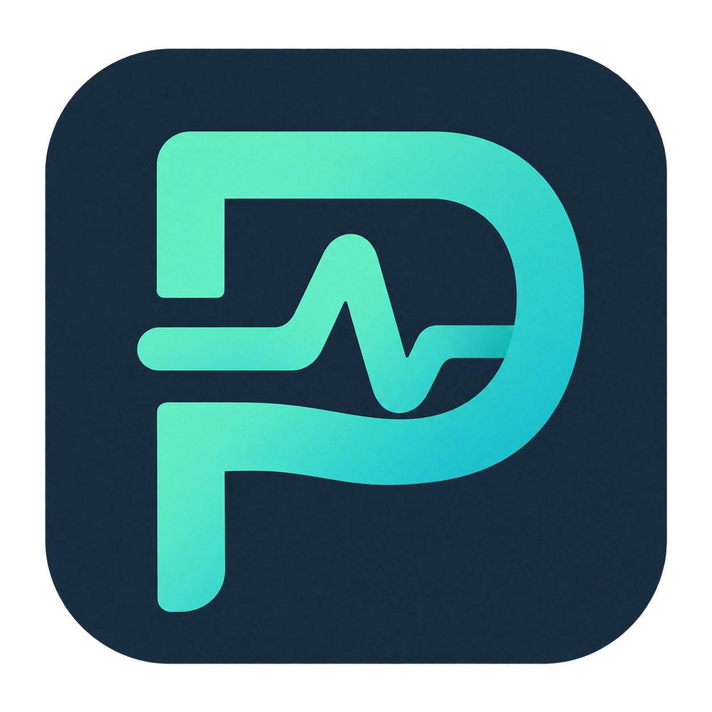
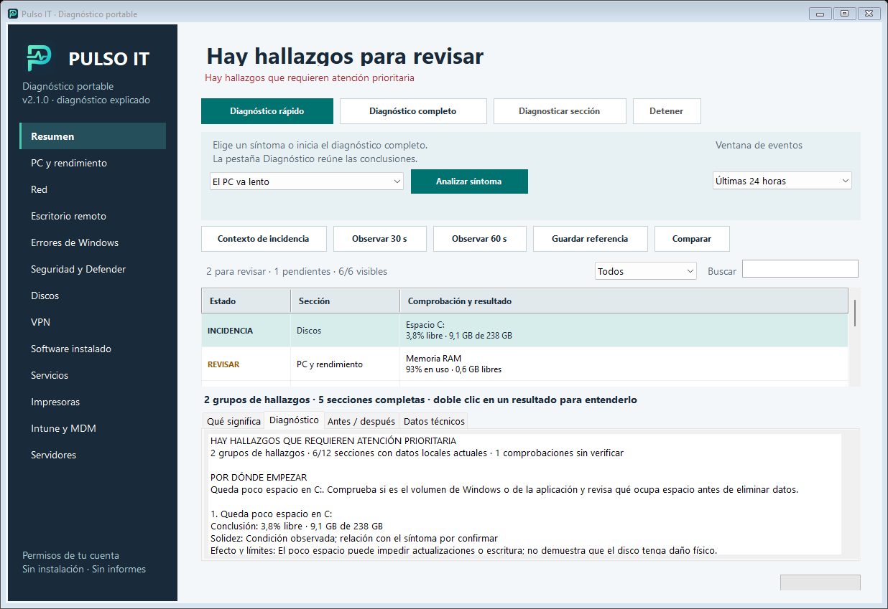

# Pulso IT



Herramienta portable de diagnóstico de Windows, con doce secciones, consultas de solo lectura y resultados en pantalla. No instala componentes, solicita elevación ni genera informes. Versión actual: **2.1.0**.

## Descargar

- [Descargar Pulso IT 2.1.0 para Windows x64 (.exe)](https://github.com/hparedes95/pulso-it/raw/refs/heads/main/descargas/Pulso-IT-Portable-v2.1.0.exe)
- [Paquete ZIP con documentación y fuentes](https://github.com/hparedes95/pulso-it/raw/refs/heads/main/descargas/Pulso-IT-Portable-v2.1.0.zip)
- [Guía detallada en español](docs/GUIA.md)
- [Hashes SHA-256](SHA256SUMS.txt)

El ejecutable es autónomo: basta con copiarlo al PC o a un USB. Requiere Windows 10/11 x64 o Windows Server x64 con escritorio, .NET Framework 4.7.2+ y Windows PowerShell 5.1. No tiene firma digital. Respeta las restricciones corporativas existentes.

## Novedades del diagnóstico explicado

El botón **Diagnóstico completo** revisa las doce secciones y observa 30 segundos de rendimiento. La pestaña **Diagnóstico** presenta una conclusión, agrupa señales relacionadas y propone el siguiente paso. **Qué significa** explica cada hallazgo; **Datos técnicos** conserva la información original. Los registros antiguos se separan de los problemas actuales. Cuando no se detectan incidencias se indica la cobertura y lo que queda sin verificar. Todo se interpreta mediante reglas locales, sin enviar los datos a una IA.

## Qué incluye

- Diagnóstico de PC/rendimiento, red, RDP, eventos, Defender, discos, VPN, software, servicios, impresoras, Intune/MDM y servidores.
- Hipótesis con evidencias, confirmación pendiente y siguiente paso; no atribuye una causa cuando faltan datos.
- Observación de 30/60 segundos con gráficas de CPU, memoria, paginación, disco y errores de red.
- Contexto y hora de la incidencia; consultas de eventos acotadas al momento elegido.
- Pruebas de DNS/TCP y HTTPS opcional con validación de certificado, sin credenciales.
- Filtros separados para problemas, pendientes y contexto; comparación antes/después solo en memoria.
- Los doce [scripts de consola independientes](scripts-consola), conservados como versión anterior de consola.

Los resultados y referencias se pierden al cerrar. No se reinician servicios, borran colas, reparan discos, cambian redes ni inician análisis. Las consultas remotas y pruebas opcionales generan tráfico y usan los permisos ya disponibles.

## Estructura y compilación

`codigo-fuente/` contiene la aplicación C#/WinForms, consultas PowerShell embebidas, pruebas y empaquetado. `docs/` contiene la guía y el historial; `logo/` los recursos; `descargas/` los binarios comprobados; `scripts-consola/` los scripts previos.

En Windows x64, con Python 3 instalado:

```powershell
cd codigo-fuente
python build.py
python test_checks.py
python test_regression.py
python test_additional.py
python test_v2_validation.py
python test_assessment_data.py
python package.py
```

La compilación utiliza el compilador de .NET Framework del sistema, ejecuta las pruebas internas y crea `compilado/` fuera de la carpeta de fuentes. No requiere paquetes de Python externos. Las vistas de desarrollo se generan solo mediante órdenes explícitas de compilación/preview; el uso normal de la app no guarda resultados.

## Validación y límites

Pasaron las pruebas internas de interfaz, UTF-8, filtros, cancelación/timeout, hipótesis y comparación; también las pruebas simuladas de las doce secciones, accesos denegados y regresiones. Se realizó inspección visual y comprobación de geometría con escalas simuladas.

El muestreador se ejecutó en Windows: se pudieron leer métricas de red y procesos visibles. Los contadores PDH no estaban disponibles; la alternativa nativa permitió leer CPU y memoria. Paginación y disco permanecieron sin verificar. No se afirma validación completa de hardware, VPN, Intune, impresoras, servidores o HTTPS real: hace falta un piloto en los equipos de la organización. Los valores ausentes no se convierten en cero; los umbrales son orientativos.



Las imágenes incluidas son demostraciones. Consulta la [guía](docs/GUIA.md) para conocer el alcance, la privacidad y las referencias técnicas de cada comprobación.
